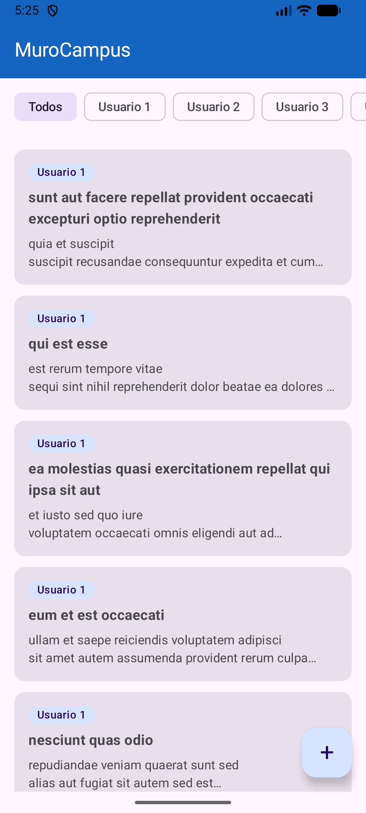
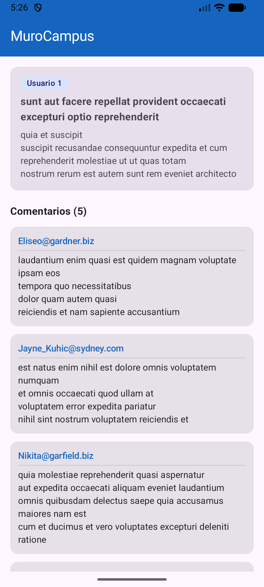
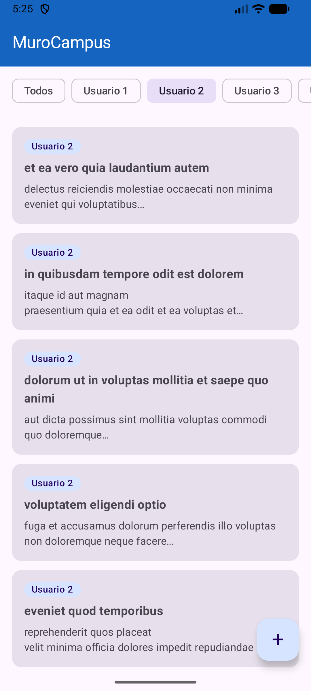
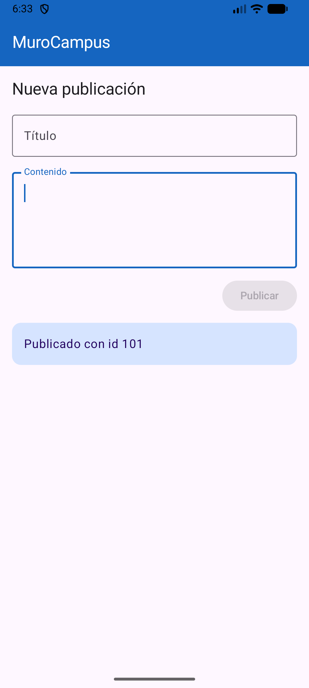
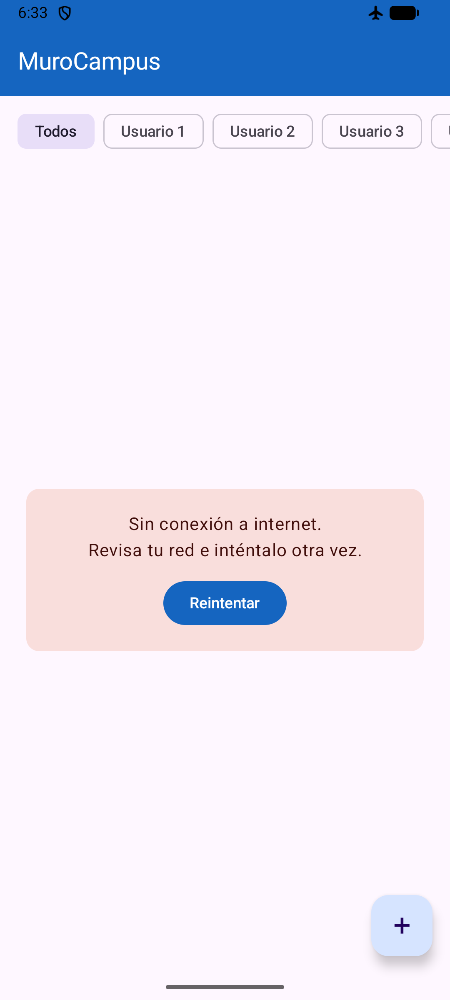

# MuroCampus

App Android que consume un servicio web REST ([JSONPlaceholder](https://jsonplaceholder.typicode.com/)). Lista publicaciones, muestra el detalle con sus comentarios, filtra por usuario y crea publicaciones nuevas. Funciona bien también sin internet: muestra el error y deja reintentar.

- **Tecnología:** Kotlin, Jetpack Compose, Material 3, Retrofit, OkHttp, kotlinx.serialization y corrutinas.
- **Arquitectura:** MVVM + Repository (interface) con `Result` y `UiState`.
- **Curso:** Programación en Móviles, Laboratorio 9 (Servicios web y plataforma REST).

## La API

| Para… | Verbo y ruta | Anotación |
|---|---|---|
| Listar publicaciones | `GET posts` | `@GET` |
| Ver una publicación | `GET posts/{id}` | `@Path("id")` |
| Ver sus comentarios | `GET posts/{id}/comments` | `@Path("id")` |
| Filtrar por usuario | `GET posts?userId=2` | `@Query("userId")` |
| Crear una publicación | `POST posts` con JSON en el cuerpo | `@Body` |

## Estructura de paquetes

```
com.tecsup.murocampus/
├── MainActivity.kt                  Scaffold, navegación (lista / detalle / crear) y BackHandler
├── model/
│   └── Modelos.kt                   Post, Comentario, NuevoPost (+ Usuario, ejemplo)
├── data/
│   ├── remote/
│   │   ├── PostApi.kt               interface de Retrofit (@GET, @POST, @Path, @Query, @Body)
│   │   ├── RetrofitClient.kt        object con OkHttp, log y conversor JSON
│   │   └── UsuarioApi.kt            ejemplo resuelto
│   ├── PostRepository.kt            interface + PostRepositoryRemote (devuelve Result)
│   ├── UsuarioRepository.kt         ejemplo resuelto
│   └── MensajesError.kt             mensajeDe(): IOException / HttpException / SerializationException
├── viewmodel/
│   ├── UiState.kt                   Cargando / Exito / Error
│   ├── PostsViewModel.kt            lista, detalle, filtro y publicar
│   └── PostsViewModelFactory.kt
└── ui/
    ├── Componentes.kt               TarjetaPost, Cargando, ErrorConReintento
    ├── PantallaLista.kt             chips de usuario + LazyColumn
    ├── PantallaDetalle.kt           publicación + Comentarios (N)
    ├── PantallaCrear.kt             formulario + POST
    └── theme/
```

## Arquitectura MVVM + Repository

```
View (PantallaLista, PantallaDetalle, PantallaCrear)
   |  eventos: cargar, filtrar, abrir, publicar     ^  collectAsStateWithLifecycle()
   v                                                |
ViewModel (PostsViewModel) --- StateFlow<UiState> (Cargando / Exito / Error) --->
   |  viewModelScope.launch
   v
PostRepository (interface)  <- devuelve Result<...>
   -> PostRepositoryRemote  (captura IOException, HttpException… y relanza CancellationException)
          |
          v
PostApi (Retrofit) --- OkHttp ---> https://jsonplaceholder.typicode.com/
```

| Capa | Conoce a | No debe |
|---|---|---|
| View (`ui/`) | Solo a su ViewModel | Llamar a Retrofit ni conocer `PostApi` |
| ViewModel | Solo a la interface `PostRepository` | Conocer Retrofit, `HttpException` ni `Context` |
| Repository | `PostApi` y las excepciones de red | Conocer la UI o dejar escapar excepciones |
| `data/remote` | Retrofit, OkHttp y el JSON | Guardar estado de pantalla |

`mensajeDe()` vive en `data/MensajesError.kt` y no en `viewmodel/`. Así `PostsViewModel` traduce el error sin importar `HttpException`: el paquete `viewmodel/` no menciona Retrofit, `PostApi` ni `HttpException`. Solo `PostsViewModelFactory` usa `RetrofitClient`, porque es la que arma la cadena `RetrofitClient → PostRepositoryRemote → PostsViewModel`.

## Capturas

| Lista | Detalle | Filtro (Usuario 2) |
|---|---|---|
|  |  |  |

| Crear | Error de conexión |
|---|---|
|  |  |

## Pruebas de errores

| Prueba | Cómo se provocó | Resultado | OK |
|---|---|---|---|
| Sin internet | Modo avión y abrir la app | "Sin conexión a internet" y botón Reintentar | ✅ |
| Reintentar | Quitar el modo avión y pulsar Reintentar | Carga la lista | ✅ |
| Recurso inexistente | Detalle con `posts/9999` (temporal) | "Error del servidor (404)" | ✅ |
| JSON inesperado | Quitar un campo de `Post` (temporal) | Funciona gracias a `ignoreUnknownKeys` | ☐ |
| Cancelación | Abrir el detalle y volver rápido | No hay errores en Logcat | ✅ |
| Lista y detalle | Abrir varias publicaciones | Siempre 5 comentarios | ✅ |
| Filtro | Elegir un usuario | 10 publicaciones, URL `posts?userId=N` en Logcat | ✅ |
| Crear | Enviar una publicación | "Publicado con id 101" y POST 201 en Logcat | ✅ |
| Rotar | Girar la pantalla en la lista | No vuelve a descargar (0 peticiones nuevas) | ✅ |
| Código | Revisar `viewmodel/PostsViewModel.kt` | No hay Retrofit, `PostApi` ni `HttpException` | ✅ |

## Para pensar

**1. ¿Qué diferencia hay entre GET y POST? ¿Por qué `crear` lleva `@Body` y `porUsuario` lleva `@Query`?**
`GET` **lee** un recurso y no cambia nada en el servidor. `POST` **crea** uno nuevo. `crear` necesita enviar un objeto completo (`NuevoPost`), así que va como JSON en el **cuerpo** de la petición (`@Body`). `porUsuario` solo pide una lista filtrada con un dato simple, que va en la **URL** como parámetro (`posts?userId=2`) con `@Query`.

**2. ¿Por qué la ruta es `"posts"` y no `"/posts"`?**
Retrofit combina la ruta con la URL base. Una ruta **relativa** (`posts`) se *suma* a la base: `https://jsonplaceholder.typicode.com/posts`. Una ruta que empieza con `/` es **absoluta**: reemplaza todo el camino de la URL base y deja solo el dominio. Por eso la base termina en `/` y las rutas no empiezan con `/`.

**3. ¿Por qué el Repository devuelve `Result` en vez de dejar que la excepción llegue al ViewModel?**
Así el error es un **valor** que el ViewModel debe manejar (`onSuccess` / `onFailure`), y no algo que puede olvidar capturar y que cerraría la app. Además, el ViewModel no necesita conocer `IOException` ni `HttpException` de Retrofit: si mañana cambiamos Retrofit por otra librería o por una base de datos, el ViewModel y la pantalla no cambian. La `CancellationException` sí se relanza, porque no es un error: es la corrutina terminando a propósito.

**4. ¿Qué pasa si olvidas el permiso `INTERNET`? ¿Y si olvidas `ignoreUnknownKeys` y el servidor agrega un campo nuevo?**
Sin el permiso, la app compila y abre, pero toda llamada falla con `UnknownHostException` / `SecurityException`: se ve "Sin conexión a internet" aunque haya red. Sin `ignoreUnknownKeys`, kotlinx.serialization exige que cada campo del JSON exista en la `data class`. Si el servidor agrega un campo nuevo, la conversión lanza `SerializationException` y la app muestra "Respuesta inesperada" aunque los datos que usamos sigan ahí.

**5. ¿Por qué la pantalla de lista usa un `when` sobre `UiState` y no un `if` con tres variables?**
Con tres variables (`cargando`, `datos`, `error`) pueden darse combinaciones imposibles, como `cargando = true` y `error != null` a la vez, y hay que acordarse de limpiarlas. Con una `sealed interface` el estado es **exactamente uno** de los tres. El `when` obliga a cubrir todos los casos (el compilador avisa si falta uno), y `Exito` trae los datos y `Error` el mensaje, sin nulos.

**6. JSONPlaceholder no guarda los POST. ¿Cómo cambiaría tu app si usaras un servicio real?**
Después de un POST exitoso, la publicación nueva sí aparecería al recargar. Haría falta refrescar la lista (o agregar el `Post` devuelto al inicio de la lista sin descargar todo), autenticar al usuario (token en un `Interceptor` de OkHttp) en lugar de `userId = 1` fijo, validar en el servidor y manejar más códigos (`401`, `422`…). También convendría una caché local (Room) para ver publicaciones sin internet. Las capas siguen siendo las mismas: solo cambian la URL base, `PostApi` y el Repository.

## Notas de actualización

- La guía usa versiones de hace algunos años. Este proyecto usa AGP 9.4.1, Kotlin 2.4.20, Compose BOM 2026.09, Retrofit 2.11.0, OkHttp 4.12.0 y kotlinx.serialization 1.10.0, todo en `gradle/libs.versions.toml`. Con AGP 9, Kotlin viene integrado (sin el plugin `kotlin-android`) y el plugin de serialización usa la misma versión de Kotlin.
- El ejemplo resuelto de `Usuario` y `UiState` necesitan Retrofit y kotlinx.serialization para compilar. Por eso entran en el commit del Paso 1, junto con las dependencias.
- `TarjetaPost` recibe `usuario`, `titulo` y `cuerpo` (no un `Post`), para que el proyecto base compile antes de crear los modelos en el Paso 2.
